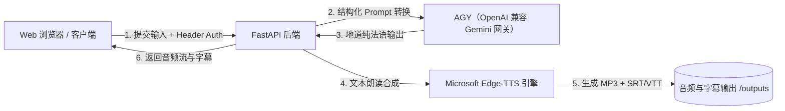

# French Audio Studio (法语音频工作台)

<p align="center">
  
  
  
  
</p>

[English](#english) | [中文说明](#中文说明)

界面开发规范：[设计原则与设计系统](DESIGN_SYSTEM.md)。学习界面是 `web/` 中的 React SPA（`/app/`），设计变量位于 `web/src/styles.css`。

---

<span id="中文说明"></span>

## 📖 项目简介

**French Audio Studio（法语音频工作台）** 是一套专为法语学习、口语练习及内容创作者设计的全流程工作台。系统结合了大语言模型（LLM）的语言处理能力与微软 Edge-TTS 高音质神经网络语音合成技术，实现从**想法/草稿/翻译 -> 地道法语文本 -> 录音级音频与同步字幕（SRT/VTT）**的一站式制作。

在线演示地址：[https://tts.gaoyuze.com/](https://tts.gaoyuze.com/)

---

## ✨ 核心特性

- 🧠 **智能文本处理（5 种处理模式）**：
  - **智能判断 (Auto)**：自动分析输入语言与意图，决定最适处理策略。
  - **按要求生成 (Generate)**：将提示词或指令直接创作出符合场景的法语文本。
  - **忠实翻译 (Translate)**：忠实传达原文信息，不偏离、不擅自扩写。
  - **自然表达 (Express)**：将零散口述或中英夹杂的想法转化为地道自然的法语表达。
  - **润色法语 (Polish)**：修正现有法语的语法拼写与表达瑕疵，保留原意。
- 🎚️ **精细语言维度调节**：
  - **表达风格**：口语化 (Spoken)、标准 (Neutral)、书面化 (Formal)、写作润色 (Polished)。
  - **CEFR 难度分级**：A1-A2（基础）、B1-B2（中级）、C1-C2（高级）。
  - **地区方言**：法国法语 (`fr-FR`)、加拿大法语 (`fr-CA`)。
- 📚 **句子深度拆解与三列精析 (Study)**：
  - **初学高频词过滤与意群绑定（Chunking）**：基于约 200 基础词过滤规则，不再机械切分 `elle`, `de`, `la`, `et`, `40` 等孤立初级词；将 `de la vie quotidienne`（loc. adj.）、`portant sur`（loc. verb.）等天然固定搭配整块解析，更符合语言习得直觉。
  - **第 1 列（原形/词组）**：规范标注词性（POS）、动词原形（Lemma）与国际音标（IPA）。
  - **单词秒级发音**：每个单词/短语旁均配备独立 🔊 按钮，点击即刻试听纯正发音。
  - **第 2 列（简明英语）**：精准提炼语境中的英文含义与时态/人称细节。
  - **第 3 列（中文释义）**：详尽中文释义与实用语法/搭配提示。
- 🧠 **费曼自测 (Study)**：先用自己的话（打字或说中文）讲这句话和关键语法，可选自己造一个新句子；AI 只指出讲对了什么、漏了什么、新句子哪里要改，并追问一个问题。
- 🗂️ **每日复习 (Review，FSRS 间隔重复，数据存服务器、多设备同步)**：
  - **以句子为单位**：拆解页点「加入复习」生成「听」「说」两张卡；点单词旁 ⭐ 生成该词在句中的「填空」卡。
  - **听**：只放音频（可慢速），回想意思；**说**：看中文开口说法语，语音识别自动打分并可回听自己的录音；**填**：输入被挖空的词块，自动判断对错与重音。
  - **FSRS 调度**：学习步长 1 分钟 / 10 分钟，按钮上显示真实的下次间隔；每天新卡上限可调，同一句子的不同卡片分天出现。
  - 旧版浏览器本地生词卡可一键导入。
- 🎙️ **跟读打分与发音复述（Shadowing）**：
  - 支持类似《每日法语听力》的沉浸式跟读评测。
  - 智能词级比对与发音对齐算法，实时输出综合评分（0-100）、准确率与完整度。
  - **逐词柔和视觉反馈**：绿色（准确）、黄色（轻微差异/联诵）、浅红（漏读或读错）。
  - **双轨录音对比**：支持一键回放“官方范读”与“我的真实录音”，清晰感知发音差异。
- 🎙️ **高自然度长音频制作 (Edge-TTS)**：
  - 支持 Denise、Henri、Vivienne、Remy、Sylvie、Jean、Antoine 等高质量 Neural 声音。
  - 同步生成时间戳字幕文件（SRT / VTT）。
  - 支持一键导出 MP3 音频与 SRT 外挂字幕。
- 🔒 **隐私与安全第一**：
  - 后端无硬编码密钥；AI 接口只接受已登录账号的会话 token，上游 Key 由服务器环境变量提供，浏览器不接触。
- 📦 **轻量可移植**：
  - 基于 FastAPI 和原生 JavaScript 前端；Python 与浏览器脚本均有自动化测试。

---

## 🏗️ 架构概览



---

## 🚀 快速开始

### 方式一：Docker Compose（推荐）

1. **克隆项目**
   ```bash
   git clone https://github.com/BenjaminGao2025/french-audio-studio.git
   cd french-audio-studio
   ```

2. **配置环境变量（必需）**
   ```bash
   cp .env.example .env
   chmod 600 .env
   # 编辑 .env：设置至少 32 个随机字符的 AUTH_SECRET，及需要 AI 时的 WEB2API_API_KEY
   ```

3. **启动容器**
   ```bash
   docker compose up -d --build
   ```

4. 打开浏览器访问：`http://localhost:8000`

---

### 方式二：本地 Python 运行

1. **环境准备**（推荐 Python 3.11+）
   ```bash
   python3 -m venv .venv
   source .venv/bin/activate  # Windows: .venv\Scripts\activate
   pip install -r requirements.txt
   ```

2. **设置环境变量并启动服务**（Python 不会自动加载 `.env`）
   ```bash
   # 一次性生成随机密钥并安全保存：
   python -c 'import secrets; print(secrets.token_urlsafe(48))'
   # 每次启动都从安全存储设置同一个 AUTH_SECRET；更换密钥会使现有会话失效。
   export AUTH_SECRET='<已保存的随机密钥>'
   # 如需 AI 功能，还需设置 WEB2API_API_KEY 和可访问的 AGY_BASE_URL。
   python tts_service.py
   # 或使用 uvicorn 启动：
   # uvicorn tts_service:app --host 0.0.0.0 --port 8000 --reload
   ```

3. 打开浏览器访问：`http://localhost:8000`

---

## ⚙️ 环境变量说明

| 变量名 | 默认值 | 描述 |
| :--- | :--- | :--- |
| `OUTPUT_DIR` | `./outputs` | 音频及字幕输出保存目录 |
| `AGY_BASE_URL` | `http://127.0.0.1:8645/v1` | AGY（OpenAI 兼容 Gemini 网关）地址，所有 AI 调用都发往这里 |
| `AGY_MODEL` | `gemini-3.8-flash-low` | 所有 AI 请求使用的上游模型 |
| `UPSTREAM_TIMEOUT_SECONDS` | `90` | 单次 AI 请求超时时间（秒） |
| `MAX_TEXT_CHARS` | `15000` | 单次输入最大字符限制 |
| `AUTH_SECRET` | （必填） | 登录 token 签名密钥，至少 32 位随机字符，未设置时服务拒绝启动 |
| `WEB2API_API_KEY` | （空） | 发给上游 AGY 的 Key；为空时 AI 接口返回 503 `server_key_missing` |
| `ALLOW_REGISTRATION` | `false` | 是否开放注册；关闭时仍可使用邀请码注册 |
| `PBKDF2_ITERATIONS` | `600000` | 新密码的 PBKDF2-SHA256 迭代次数；旧格式在成功登录时升级 |
| `RATE_AUTH_IP_BURST` / `RATE_AUTH_IP_PER_HOUR` | `20` / `30` | 登录与注册：每个客户端 IP 的令牌桶容量 / 每小时补充数 |
| `RATE_AUTH_EMAIL_BURST` / `RATE_AUTH_EMAIL_PER_HOUR` | `8` / `6` | 登录与注册：每个规范化邮箱的容量 / 每小时补充数 |
| `ASR_MODEL_DIR` / `ASR_CPU_THREADS` | `./models/faster-whisper-large-v3-turbo` / `8` | 本地语音识别模型目录 / CPU 线程数 |
| `TTS_HOST` / `TTS_PORT` | `127.0.0.1` / `8000` | `python tts_service.py` 的监听地址 / 端口 |

Compose 单独覆盖 `AGY_BASE_URL` 为 `http://127.0.0.1:3425/v1`、`AGY_MODEL` 为 `gemini-3.8-flash`；均可在 Compose 环境中覆盖。语音识别需要在模型目录中准备兼容的 faster-whisper 模型文件。限流状态保存在进程内，重启后重置，并非跨进程共享；只有来自本机代理的 `CF-Connecting-IP` 会被信任。

---

## 🧭 前端与架构

学习界面是 `web/` 中按 1000H French 设计实现的 React SPA，挂在 `/app/`；旧路径（`/study`、`/review`、`/listen`、`/write`、`/speak`、`/account` 等）302 跳到 `/app/…`。`static/` 只剩公开页（`/home`、`/privacy`、`/for-institutions`）和 PWA 文件。SPA 由 Docker 构建阶段编译，产物不进 git；开发时在 `web/` 中运行 `npm ci && npm run dev`（`/api` 代理到本机 8000 端口），测试用 `npm test` 和 `npm run typecheck`。更多实现细节见 [ARCHITECTURE.md](ARCHITECTURE.md)，界面规范见 [DESIGN_SYSTEM.md](DESIGN_SYSTEM.md)。

## 🧪 运行测试

```bash
python -m pip install -r requirements.txt ruff==0.17.4
npm ci --prefix web          # Node.js 22
ruff check .
python -m unittest discover -s tests
npm --prefix web run typecheck
npm --prefix web test
```

CI 在 GitHub 托管的 runner 上运行 lint、Python 测试，以及 `web/` 的类型检查和测试；生产部署在自托管 runner 上构建候选镜像，并用该镜像运行 Python 测试，备份数据库后才重启。推送到 `main` 会触发生产部署，请通过分支和 PR 审核。

## 💾 备份与清理

部署时使用 SQLite 在线备份把 `outputs/users.db` 的一致快照保存到 `outputs/backups/`，默认保留 14 份；找不到 `users.db` 时以非零状态退出（部署因此中止），不会在没有备份的情况下继续。备份与数据库在同一磁盘，应另行复制到异地并定期验证恢复。清理脚本只处理指定命名规则的旧短语音缓存与过期临时文件，不清理数据库引用的音频；找不到 `users.db` 时拒绝运行并以非零状态退出；默认预览，不自动运行：

```bash
docker exec tts-service python scripts/prune_outputs.py              # 预览
docker exec tts-service python scripts/prune_outputs.py --apply      # 执行（默认 60 天）
docker exec tts-service python scripts/backup_db.py --label manual  # 手动备份
```

使用记录（第一方，只存在 `users.db` 的 `ui_events` 表，保留 180 天，不记录输入的文字）：

```bash
docker exec tts-service python scripts/usage_report.py --email you@example.com --days 30   # 页面时长、常用操作、漏斗、报错
```

请先检查预览并备份，再执行清理。`python auth_db.py --help` 查看密码、套餐、邀请码及候补名单等管理命令。

---

<span id="english"></span>

## 🌐 English Overview

**French Audio Studio** is an all-in-one workbench tailored for French learners, communicators, and content creators. It seamlessly connects modern LLM intelligence with Microsoft Edge neural text-to-speech engine to transform ideas, drafts, and notes into authentic French text, paired with high-quality MP3 audio and synchronized SRT/VTT subtitles.

### Key Capabilities

- **Intelligent French Transformation**: Auto mode, direct generation, faithful translation, natural phrasing, and French polishing.
- **Expressive Nuance Controls**: 4 styles (spoken, neutral, formal, polished), 3 CEFR levels (A1-C2), and 2 dialects (France / Canada).
- **High-Fidelity Neural Speech**: Multiple edge-tts neural voices with subtitle sync and one-click download.
- **Privacy First**: Zero hardcoded secrets, server-held upstream key, and full request-level security isolation.
- **Production-Ready**: FastAPI async backend, React SPA under `/app/`, containerized with Docker.

---

## 📄 开源许可证

旧版 README 曾声明 MIT，但仓库缺少许可证文件；在版权人确认并补充许可证之前，请勿假定已获得授权。

## 已移除的界面

2026-11 切换到新 SPA 时，学习教练（`/coach`）、语法地图（`/grammar`）、个人表达练习（`/homework`，原 Study 中的“练我想说的话”）和会员页（`/account`）的前端已删除。旧链接跳到 `/app/…`：前三个显示“已移除”说明，`/account` 跳到 Settings。这些功能的后端接口和用户数据保留，没有删除。
