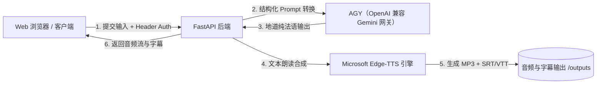

# French Audio Studio (法语音频工作台)

<p align="center">
  
  
  
  
  
</p>

[English](#english) | [中文说明](#中文说明)

界面开发规范：[设计原则与设计系统](DESIGN_SYSTEM.md)。共享设计变量位于 `static/tokens.css`，组件视觉规则位于 `static/ui.css`。

---

<span id="中文说明"></span>

## 📖 项目简介

**French Audio Studio（法语音频工作台）** 是一套专为法语学习、口语练习及内容创作者设计的全流程工作台。系统结合了大语言模型（LLM）的语言处理能力与微软 Edge-TTS 高音质神经网络语音合成技术，实现从**想法/草稿/翻译 -> 地道法语文本 -> 录音级音频与同步字幕（SRT/VTT）**的一站式制作。

在线演示地址：[https://tts.gaoyuze.com/](https://tts.gaoyuze.com/)

---

## ✨ 核心特性

- 🧠 **智能文本处理（5 种处理模式）**：
  - **智能判断 (Auto)**：自动分析输入语言与意图，决定最适处理策略。
  - **按要求生成 (Generate)**：将提示词或指令直接创作出符合场景的法语文本。
  - **忠实翻译 (Translate)**：忠实传达原文信息，不偏离、不擅自扩写。
  - **自然表达 (Express)**：将零散口述或中英夹杂的想法转化为地道自然的法语表达。
  - **润色法语 (Polish)**：修正现有法语的语法拼写与表达瑕疵，保留原意。
- 🎚️ **精细语言维度调节**：
  - **表达风格**：口语化 (Spoken)、标准 (Neutral)、书面化 (Formal)、写作润色 (Polished)。
  - **CEFR 难度分级**：A1-A2（基础）、B1-B2（中级）、C1-C2（高级）。
  - **地区方言**：法国法语 (`fr-FR`)、加拿大法语 (`fr-CA`)。
- 📚 **句子深度拆解与三列精析 (`/study`)**：
  - **初学高频词过滤与意群绑定（Chunking）**：基于约 200 基础词过滤规则，不再机械切分 `elle`, `de`, `la`, `et`, `40` 等孤立初级词；将 `de la vie quotidienne`（loc. adj.）、`portant sur`（loc. verb.）等天然固定搭配整块解析，更符合语言习得直觉。
  - **第 1 列（原形/词组）**：规范标注词性（POS）、动词原形（Lemma）与国际音标（IPA）。
  - **单词秒级发音**：每个单词/短语旁均配备独立 🔊 按钮，点击即刻试听纯正发音。
  - **第 2 列（简明英语）**：精准提炼语境中的英文含义与时态/人称细节。
  - **第 3 列（中文释义）**：详尽中文释义与实用语法/搭配提示。
- 🧠 **费曼自测 (`/study`)**：先用自己的话（打字或说中文）讲这句话和关键语法，可选自己造一个新句子；AI 只指出讲对了什么、漏了什么、新句子哪里要改，并追问一个问题。
- 🗂️ **每日复习 (`/review`，FSRS 间隔重复，数据存服务器、多设备同步)**：
  - **以句子为单位**：拆解页点「加入复习」生成「听」「说」两张卡；点单词旁 ⭐ 生成该词在句中的「填空」卡。
  - **听**：只放音频（可慢速），回想意思；**说**：看中文开口说法语，语音识别自动打分并可回听自己的录音；**填**：输入被挖空的词块，自动判断对错与重音。
  - **FSRS 调度**：学习步长 1 分钟 / 10 分钟，按钮上显示真实的下次间隔；每天新卡上限可调，同一句子的不同卡片分天出现。
  - 旧版浏览器本地生词卡可一键导入。
- 🎙️ **跟读打分与发音复述（Shadowing）**：
  - 支持类似《每日法语听力》的沉浸式跟读评测。
  - 智能词级比对与发音对齐算法，实时输出综合评分（0-100）、准确率与完整度。
  - **逐词柔和视觉反馈**：绿色（准确）、黄色（轻微差异/联诵）、浅红（漏读或读错）。
  - **双轨录音对比**：支持一键回放“官方范读”与“我的真实录音”，清晰感知发音差异。
- 🎙️ **高自然度长音频制作 (Edge-TTS)**：
  - 支持 Denise、Henri、Vivienne、Remy、Sylvie、Jean、Antoine 等高质量 Neural 声音。
  - 同步生成时间戳字幕文件（SRT / VTT）。
  - 支持一键导出 MP3 音频与 SRT 外挂字幕。
- 🔒 **隐私与安全第一**：
  - 后端无硬编码密钥；AI 接口只接受已登录账号的会话 token，上游 Key 由服务器环境变量提供，浏览器不接触。
- 📦 **轻量可移植**：
  - 基于 FastAPI + 原生现代化前端，无重型框架依赖，启动毫秒级，附带 40 项自动化测试全绿。

---

## 🏗️ 架构概览



---

## 🚀 快速开始

### 方式一：Docker Compose（推荐）

1. **克隆项目**
   ```bash
   git clone https://github.com/BenjaminGao2025/french-audio-studio.git
   cd french-audio-studio
   ```

2. **配置环境变量（可选）**
   ```bash
   cp .env.example .env
   ```

3. **启动容器**
   ```bash
   docker compose up -d --build
   ```

4. 打开浏览器访问：`http://localhost:8000`

---

### 方式二：本地 Python 运行

1. **环境准备**（推荐 Python 3.11+）
   ```bash
   python3 -m venv .venv
   source .venv/bin/activate  # Windows: .venv\Scripts\activate
   pip install -r requirements.txt
   ```

2. **启动服务**
   ```bash
   python tts_service.py
   # 或使用 uvicorn 启动：
   # uvicorn tts_service:app --host 0.0.0.0 --port 8000 --reload
   ```

3. 打开浏览器访问：`http://localhost:8000`

---

## ⚙️ 环境变量说明

| 变量名 | 默认值 | 描述 |
| :--- | :--- | :--- |
| `OUTPUT_DIR` | `./outputs` | 音频及字幕输出保存目录 |
| `AGY_BASE_URL` | `http://127.0.0.1:8645/v1` | AGY（OpenAI 兼容 Gemini 网关）地址，所有 AI 调用都发往这里 |
| `AGY_MODEL` | `gemini-3.8-flash-low` | 实际应答所有请求的模型；客户端传来的任何旧模型名都会映射到它 |
| `UPSTREAM_TIMEOUT_SECONDS` | `120` | 单次 AI 请求超时时间（秒） |
| `MAX_TEXT_CHARS` | `15000` | 单次输入最大字符限制 |
| `AUTH_SECRET` | （必填） | 登录 token 签名密钥，至少 32 位随机字符，未设置时服务拒绝启动 |
| `WEB2API_API_KEY` | （空） | 发给上游 AGY 的 Key；为空时 AI 接口返回 503 `server_key_missing` |
| `ALLOW_REGISTRATION` | `false` | 是否开放注册（个人使用保持关闭，账号用 `python auth_db.py` 管理） |

---

## 🧪 运行测试

项目内置完整的单元测试套件（覆盖端点认证、降级机制、音视频输出校验与容错处理）：

```bash
python -m unittest discover -s tests -p 'test_*.py'
```

---

<span id="english"></span>

## 🌐 English Overview

**French Audio Studio** is an all-in-one workbench tailored for French learners, communicators, and content creators. It seamlessly connects modern LLM intelligence with Microsoft Edge neural text-to-speech engine to transform ideas, drafts, and notes into authentic French text, paired with high-quality MP3 audio and synchronized SRT/VTT subtitles.

### Key Capabilities

- **Intelligent French Transformation**: Auto mode, direct generation, faithful translation, natural phrasing, and French polishing.
- **Expressive Nuance Controls**: 4 styles (spoken, neutral, formal, polished), 3 CEFR levels (A1-C2), and 2 dialects (France / Canada).
- **High-Fidelity Neural Speech**: Multiple edge-tts neural voices with subtitle sync and one-click download.
- **Privacy First**: Zero hardcoded secrets, server-held upstream key, and full request-level security isolation.
- **Production-Ready**: FastAPI async backend, minimal native web interface, containerized with Docker.

---

## 📄 开源许可证

本项目采用 [MIT License](LICENSE) 许可证。

## 学习教练与个人表达训练

`/coach` 从目标、截止日期、四项自评水平、学习日、时段和限制生成个人安排。
每天的任务总分钟数受可用时间限制；AI 补充追问、任务侧重和每周复盘建议。
AI 不可用时保留已有计划；用户用“更新安排”或修改时间采纳调整。
站内提醒需主动开启，仅在页面打开且可见时工作。

`/study?mode=personal`（Study 内的“练我想说的话”，旧 `/homework` 自动跳转）将 [1000H 启动任务](https://1000h.org/training-tasks/kick-off.html) 的个人表达、反复练习和每日存档用于法语：
自己的中文内容 → 简单法语和范读 → 第一遍录音 → 跟读、朗读、脱稿换细节 → 最后一遍录音 → 心得。
保留完整原意，按水平分段生成简单法语，首尾录音私有保存，可下载包含文本、范读、录音和心得的 ZIP。
录音每段 1–180 秒、最多 8 MB。第一遍保留；最后一遍可有多个版本。
开口练习计时根据麦克风活动估算，在后台或播放音频时暂停，环境声音可能影响估计。
录音文件按实际时长记录（可能包含停顿）；重复上传同一段不重复累计。
练习与游戏 XP 不代表 CEFR/NCLC 认证；脱稿完成为用户自评。

写作提供 P0（A1 起步）、P1（A1 巩固）、P2（A2）与独立的 TCF T1/T2/T3 模式。
听力提供短句精听、提示和每周小挑战；A1 的历史材料按短句和基础词汇保守筛选。
教练按练习完成证据复盘，区分系统记录和线下手动确认。

验证不调用真实模型或语音，也不修改真实账号：

```bash
# 容器中的依赖可用于隔离测试，仓库以只读方式挂载
 docker run --rm --network none -v "$PWD:/app:ro" deploygrow-tts:latest python -m unittest discover -s tests -q
# 先生成临时数据库里的界面样本，再运行模拟浏览器流程
 docker run --rm --network none -v "$PWD:/app:ro" deploygrow-tts:latest python tools/coach-fixture.py > /tmp/tts-coach-fixture.json
 node tools/coach-ui-check.cjs
```


2026-10-15：个人表达练习已整合进 Study。完整保留原文信息，分成小段法语并保存每段对应的原文；可选择整篇或一段范读，在当前页逐句拆解并返回录音练习。旧简略稿尚未录音时可主动补全；已有录音的版本保持原文。范读/录音通过 Bearer 验证加载为本地 blob，显示加载、就绪和失败重试；音频生成失败时保留已生成的法语，重试无需再次调用文本模型。个人练习显示时暂停 Study 的阅读自动计时，开口活动与录音仍分别按原机制记录。
